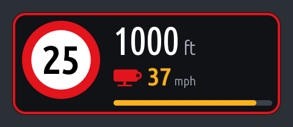

# BMW Sugar Apps — custom apps for BMW iDrive 7 (MGU)

*Українською: [README.uk.md](README.uk.md)*

Apps for the BMW iDrive 7 head unit (MGU, e.g. G01 X3, G20 3 Series, G30 5 Series), installed through the
community [MGU Store](https://github.com/robertnisipeanu/mgu-store). This repository is one Store source: the head
unit downloads an app's source from here and builds it itself.

> **Unofficial, not affiliated with BMW. Needs root access to the head unit. Use at your own risk.**
> Read [LEGAL.md](LEGAL.md) before installing: disclaimer, the law on speed camera warnings, data licences.

## 🇺🇦 Made in Ukraine

These apps are made in Ukraine. Russia is the aggressor in the war against Ukraine: its full-scale invasion of
24 February 2022 continues the aggression it began in 2014 with the occupation of Crimea and parts of Donbas. The UN
General Assembly condemned it as aggression (resolution ES-11/1, 2 March 2022). If these apps are useful to you,
please support Ukraine, for example through [UNITED24](https://u24.gov.ua), the official fundraising platform of
Ukraine. SpeedCam says the same in the last row of its settings.

## Apps

| App | Folder | Version | What it does | Manual |
|---|---|---|---|---|
| SpeedCam | `apps/speedcam_ua` | 0.5.1 | Offline speed camera warnings on the head-up display, the instrument cluster and inside the Waze / Google map on the cluster. Ukraine (official police list), Europe and the USA (OpenStreetMap), 8 languages, a chime, monthly database updates | [English](docs/speedcam_ua/README.en.md) · [Українська](docs/speedcam_ua/README.md) |

### SpeedCam at a glance

| HUD | Instrument cluster | Inside the Waze / Google map |
|---|---|---|
|  |  |  |

| France: danger zone only | USA: mph | German |
|---|---|---|
|  |  |  |


- Uses the car's own GPS: no phone, no internet needed while driving.
- Warns ahead of the camera (distance = speed × 20 s, 300 m at least), shows the limit, your speed (amber over the
  limit, red and blinking far over it) and a bar that runs out at the camera. Optional chime over the music.
- Ukraine: the Patrol Police's official list. Europe (EU + UK, Norway, Switzerland, Balkans, Moldova) and the 50 US
  states: OpenStreetMap. Packs per country / state; the one where the car is loads by itself.
- **Respects the law by default:** off in Germany, Switzerland, Liechtenstein, Cyprus, North Macedonia (can be switched
  on at your own responsibility); France: danger zones only. See [LEGAL.md](LEGAL.md).
- Languages: Українська, English, Deutsch, Polski, Français, Italiano, Español, Čeština.
- **Tested on a real car:** the author's 2021 BMW X3 (G01, iDrive 7): GPS, HUD, cluster, the banner in the Waze / Google
  map and the chime, on Ukrainian roads. Europe and the USA (packs, legal modes, mph) and the languages are tested on a PC
  (`test/speedcam_ua/e2e_drive.js`) so far.

## Install

You need a head unit with root access and the MGU Store installed (see the
[MGU Store's guide](https://github.com/robertnisipeanu/mgu-store)), plus its **cluster-render** service (in the Store).

1. Store → Settings → **Add source** → `Zakh294/bmw-sugar-apps`, branch **`main`** → **Check now**.
2. Pick the app → **Install**. The head unit builds it (a minute or two).
3. Updates: Installed → **Update all** (a new app version), and SpeedCam's camera databases update themselves once a
   month from this repository. Roughly how many cars use it:
   [STATS.md](docs/speedcam_ua/STATS.md).

Step-by-step with pictures: [SpeedCam manual](docs/speedcam_ua/README.en.md).

## Branches

- **`main`** — stable, the one to connect in the car.
- **`dev`** — testing. Switch the Store source to `dev` to try something, then back to `main`. Don't add both: same
  app ids, the Store installs the newer version.
- **`release/<id>-<version>`** — known-good versions to roll back to (switch the source branch, Check now; if the
  installed version is newer, Remove the app first).
- The camera databases are rebuilt on the 2nd of every month by a GitHub workflow
  ([.github/workflows/camera-packs.yml](.github/workflows/camera-packs.yml)), committed to `main`.

## Repository layout

```
mgu-repo.json            the Store's description: every folder apps/* is an app
apps/<id>/               an app's code (app.json, main.js, icon.png, modules); a subfolder is a data pack
apps/speedcam_ua/packs/  the camera databases (index.json + one JSON per country / US state)
docs/<id>/               manuals and pictures
data/<id>/               source data (e.g. the Ukrainian list as JSON, GeoJSON, CSV, KML, GPX)
tools/                   build step on the car (store_build.py), font baking, per-app scripts
test/<id>/, test/lib/    tests
kit/                     MGU App Kit (cauliflowermossgrape, MIT), its fonts extended with European letters
```

## Development

- Code runs on the car's **Node 8.16.2**: no `?.`, `??`, `catch {}`, object spread.
- Tests: `node test/speedcam_ua/unit.js`, `node test/speedcam_ua/e2e_drive.js`, `python3 test/speedcam_ua/packs_test.py`;
  preview: `python3 kit/tools/build.py --preview-only speedcam_ua`.
- Contributing (languages, cameras, code): [CONTRIBUTING.md](CONTRIBUTING.md).

## Licences

Code: MIT ([LICENSE](LICENSE)). `kit/`: MIT (cauliflowermossgrape). `cluster_render_client.js`: MPL-2.0 (Robert
Nisipeanu). Fonts: Ubuntu Font Licence / SIL OFL. Camera data: Ukrainian police list (public information);
© OpenStreetMap contributors, ODbL 1.0. Details: [LEGAL.md](LEGAL.md).

**Never in this repository:** head unit SSH keys, tokens, VIN-bound backups (FA, SVT, coding, E-Sys files).
