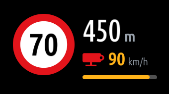
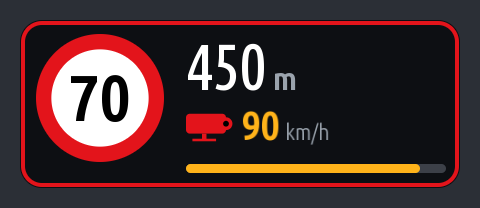

# SpeedCam UA — попередження про камери на HUD і приладці BMW (iDrive 7)

Офлайн-додаток для головного блока MGU (iDrive 7). Бере GPS з навігації самої машини і має вбудовану базу всіх 426 камер автофіксації з офіційного списку патрульної поліції. Коли під'їжджаєш до камери, показує попередження на проєкції (HUD) і на приладовій панелі: знак обмеження, відстань, твою швидкість і смужку, що зменшується до камери. Телефон та інтернет не потрібні.

Додаток ставиться через MGU Store, так само як Cluster Themes і HUD Widgets, і малює через той самий `cluster-render`.

 

> **Стан:** у машині ще не перевірявся. На ПК пройдено повну імітацію: збірку, як її робить Store, заглушку головного блока, фейковий cluster-render і проїзд повз реальну камеру з бази (`test/e2e_drive.js`). Що саме перевірити в машині — нижче.

## Що в репозиторії

| Шлях | Що це |
|---|---|
| `apps/speedcam_ua/` | сам додаток (Node 8, як на блоці) |
| `apps/speedcam_ua/cameras.js` | вбудована база камер, згенерована з `data/cameras.json` |
| `data/` | база у форматах JSON, GeoJSON, CSV, KML, GPX + звірка з OpenStreetMap (`data/README.md`) |
| `tools/store_build.py` | крок збірки в машині: шукає, звідки брати GPS, і запускає збірку App Kit |
| `tools/find_position.js` | діагностика по SSH: де прошивка віддає координати |
| `tools/import_cameras.py`, `tools/gen_app_data.py` | оновлення бази з сайту поліції |
| `docs/WAZE_GOOGLE.md` | варіант із Waze / Google Maps / OsmAnd |
| `kit/` | MGU App Kit від cauliflowermossgrape (MIT), без змін |
| `test/` | тести: `node test/unit.js`, `node test/e2e_drive.js` |

## Встановлення

Потрібно, щоб на блоці вже стояли MGU Store і **cluster-render** версії 0.5.1 або новішої. Обидва вже є, бо через cluster-render працюють Cluster Themes і HUD Widgets.

1. **Дай Store доступ до приватного репозиторію.** На GitHub створи токен: Settings → Developer settings → Fine-grained tokens → доступ лише до цього репозиторію, права Contents: Read-only. Потім на ноутбуці в PowerShell (машина на хотспоті `DIRECT-BMW`):
   ```powershell
   & ([scriptblock]::Create((irm https://raw.githubusercontent.com/robertnisipeanu/mgu-store/main/deploy/install.ps1))) token --identity $HOME\.ssh\mgu_root_key
   ```
   Встав токен, коли скрипт його попросить.
2. **Додай джерело.** Store → Settings → **Add source** → `Zakh294/bmw-speedcam-ua` → **Branch** `main`. Це дерево вихідного коду, як `bimmer-lab/apps`: блок збирає додаток сам. Потім **Check now**.
3. Store → **SpeedCam UA** → **Install**. Під час збірки (1–2 хв) блок сам знаходить у своєму каталозі інтерфейсів, звідки брати координати машини, і вбудовує це в додаток.
4. Якщо з'явиться *Restart pending*: Settings → **Restart head unit**.

Додаток запускається сам після кожного старту блока (`autostart`). Відкривати його не обов'язково: він працює у фоні.

## Що перевірити в машині (по порядку)

1. **Меню додатків → SpeedCam UA.** Відкриється сторінка стану.
   - Рядок **DISPLAY** має бути зелений: `cluster-render connected`.
   - У списку **GPS SOURCES ON THIS UNIT** має бути хоча б один рядок. Якщо там пише «No GPS source found», переходь до розділу «Якщо координат немає».
2. **Кнопка «Test warning»** (можна на стоянці). На HUD і на приладці на 14 секунд з'явиться тестове попередження: знак «50», відстань від 800 м до 0, червона швидкість 72. **Так перевіряється відмальовка.**
   - Рисунка немає ні там, ні там — подивись рядок DISPLAY (стан шарів HUD і приладки) і лог (нижче).
   - Якщо попередження на приладці закриває щось потрібне, переклади його: Settings → Place on the cluster (середина, ліво чи право).
3. **Поїзди кілька сотень метрів.** У рядку **POSITION** мають з'явитися зелені координати, `heading …` і **NEAREST** — найближча камера з відстанню. Біля потрібного джерела в списку стоятиме `>`, кількість фіксів і одиниця (`1e-7 deg` тощо).
4. **Проїдь повз будь-яку камеру.** Попередження з'являється приблизно за 20 секунд до камери (не ближче ніж за 300 м) і зникає, щойно її проїхав.

## Якщо координат немає

Значить, у прошивці координати лежать під іменем, яке пошук не впізнав. Запусти діагностику: вона лише читає каталог, нічого не пише й нічого не надсилає в шину. Команда для **cmd**, не PowerShell, з папки репозиторію:

```bat
ssh -i %USERPROFILE%\.ssh\mgu_root_key -o HostKeyAlgorithms=+ssh-rsa -o PubkeyAcceptedAlgorithms=+ssh-rsa root@172.16.222.97 "node -" < tools\find_position.js
```

Скопіюй мені вивід. Додатково можна подивитися інтерфейси за частиною імені: `"node - navi"` або `"node - posit"`. Якщо `node` не знаходиться, шукай його так: `"ls /usr/bin/node* /opt/*/bin/node 2>/dev/null"`.

**Лог додатка:**
```bat
ssh -i %USERPROFILE%\.ssh\mgu_root_key -o HostKeyAlgorithms=+ssh-rsa -o PubkeyAcceptedAlgorithms=+ssh-rsa root@172.16.222.97 "tail -n 80 $(find / -name speedcam_ua.log 2>/dev/null | head -1)"
```
Корисні рядки: `position: … watched`, `position: … in 1e-7 deg`, `position source: …`, `cluster-render ready`, `camera ahead: #…`. Координат у лозі немає, лише назви полів.

**Якщо Store не встановлює додаток** і пише про інтерфейс (`IFConfigGenerator`, `Interface … not found`, ACL), напиши текст помилки. Пошук GPS при збірці вимикається одним файлом (`apps/speedcam_ua/position.disable`). Тоді додаток встановиться без GPS: тестова кнопка працюватиме, а джерело координат підключимо вручну за виводом `find_position.js`.

## Як працює попередження

- **Курс** обчислюється з руху: це азимут між двома точками на відстані щонайменше 12 м одна від одної. Нових попереджень немає, поки машина їде повільніше 8 км/год або курс ще не відомий.
- Камера вважається **попереду**, якщо азимут на неї відрізняється від курсу не більше ніж на 30°, а ближче 200 м — не більше ніж на 60°.
- **Відстань попередження** = швидкість × 20 с, але не менше 300 м і не більше 1,2 км. Обидва значення змінюються в Settings.
- **Швидкість** на рисунку біла в межах ліміту, жовта понад ліміт і червона з блиманням, якщо перевищення більше ніж на 20 км/год (з цього порогу в Україні виписують штраф).
- Попередження зникає, коли камеру проїхали. Ця камера та її «пара» в радіусі 200 м (камера на зустрічній смузі, таких пар у базі 70) мовчать 2 хвилини.
- **Шари.** Усі шари класу `alert`, тобто поверх тем Cluster Themes, HUD Widgets і мапи Waze on Cluster. Коли попередження немає, шари приховані, і екран повністю ваш. На HUD рисунок стоїть праворуч від власної швидкості BMW і знака обмеження, тож їх не закриває.

## Обмеження (поки що)

- В офіційному списку **немає напрямку**, який контролює камера. Тому камера, що дивиться на зустрічну смугу, теж дасть попередження.
- **Звуку немає**, лише картинка. Щоб подати гонг BMW, ще треба знайти потрібний інтерфейс.
- **Пересувні камери і «Фантоми»** не враховуються: у базі тільки стаціонарні комплекси.
- Підтримується лише iDrive 7 (MGU). На iDrive 8 цілі cluster-render інші.

## Оновлення бази

Поліція оновлює список, коли вмикає нові комплекси. Наприклад, з 20.08.2026 їх стало 426. Щоб оновити:
```sh
python3 tools/import_cameras.py --fetch     # або: python3 tools/import_cameras.py збережена_сторінка.html
python3 tools/gen_app_data.py
python3 tools/verify_osm.py                  # необов'язково: звірка з OpenStreetMap, ~8 хв
```
Далі підніми `version` в `apps/speedcam_ua/app.json` і запуш. У Store натисни Installed → **Update all**.

## Розробка

```sh
node test/unit.js                  # геометрія, розпізнавання координат, транслітерація, база
node test/e2e_drive.js preview     # збірка як у машині + проїзд повз камеру; картинки в preview/
python3 kit/tools/build.py --preview-only speedcam_ua
```
Блок працює на Node **8.16.2**: без `?.`, `??` і `catch {}`. Збірку в машині запускає Python 3.12 з `mgu-python`.

## Ліцензії та подяки

- Код додатка — MIT.
- `kit/` — MGU App Kit, © cauliflowermossgrape, MIT (`kit/LICENSE.kit`).
- `apps/speedcam_ua/cluster_render_client.js` — © Robert Nisipeanu, MPL-2.0 (з `robertnisipeanu/idrive-apps`).
- Шрифти Barlow — SIL OFL.
- Дані — офіційний перелік приладів контролю патрульної поліції: https://patrolpolice.gov.ua/automatic_fixation/informatsiya-pro-vstanovleni-kaf/

Неофіційний додаток, не від BMW. Тільки читає дані машини й нічого не записує в блоки керування. Використовуєш на свій ризик. Попередження довідкові: стеж за знаками.
