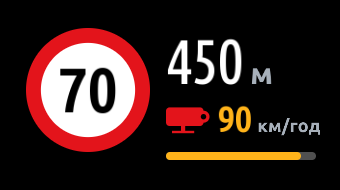
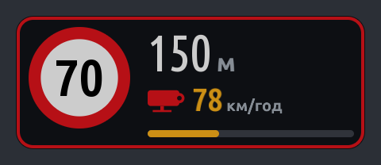
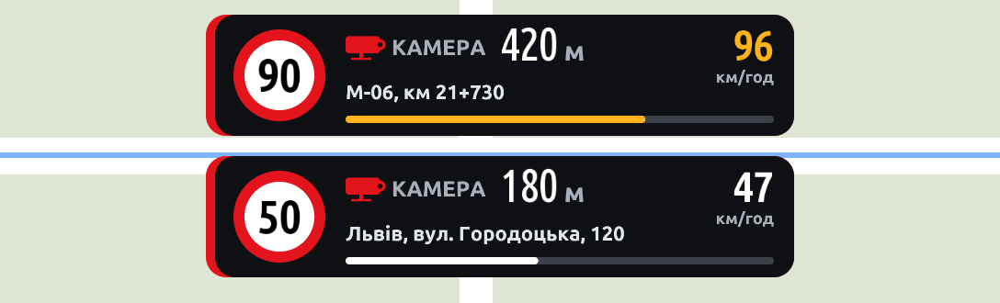
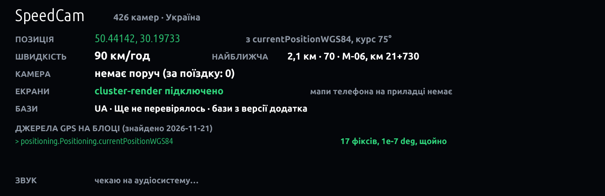

# BMW Sugar Apps — власні додатки для BMW iDrive 7 (MGU)

*English: [README.md](README.md)*

Додатки для головного блока BMW iDrive 7 (MGU: G01 X3, G20 3 серії, G30 5 серії та інші). Ставляться через
[MGU Store](https://github.com/robertnisipeanu/mgu-store) — магазин додатків від спільноти. Цей репозиторій — одне
джерело Store: блок сам завантажує звідси вихідний код додатка й збирає його.

> **Неофіційно, не від BMW. Потрібен root-доступ до головного блока. Усе на твій ризик.**
> Перед установкою прочитай [LEGAL.md](LEGAL.md): відмова від відповідальності, закони про попередження про камери,
> ліцензії даних.

## 🇺🇦 Зроблено в Україні

Ці додатки зроблено в Україні. Росія — держава-агресор у війні проти України: повномасштабне вторгнення 24 лютого
2022 року продовжує агресію, яку вона почала 2014 року окупацією Криму й частини Донбасу. Генеральна Асамблея ООН
засудила це як агресію (резолюція ES-11/1, 2 березня 2022). Якщо ці додатки тобі корисні, підтримай Україну,
наприклад через [UNITED24](https://u24.gov.ua) — офіційну платформу збору коштів. SpeedCam нагадує про це в
останньому рядку своїх налаштувань.

## Додатки

| Додаток | Папка | Версія | Що робить | Інструкція |
|---|---|---|---|---|
| SpeedCam | `apps/speedcam_ua` | 0.5.2 | Офлайн-попередження про камери швидкості на HUD, приладці та всередині мапи Waze / Google на приладці. Україна (офіційний список поліції), Європа і США (OpenStreetMap), 8 мов, звуковий сигнал, оновлення баз раз на місяць | [Українська](docs/speedcam_ua/README.md) · [English](docs/speedcam_ua/README.en.md) |

| HUD | Приладка | У мапі Waze / Google |
|---|---|---|
|  |  |  |



- Працює від GPS машини, без телефона й без інтернету в дорозі.
- Попереджає заздалегідь (відстань = швидкість × 20 с, не менше 300 м). Показує ліміт, твою швидкість (жовта понад
  ліміт, червона й блимає далеко понад) і смугу, яка закінчується біля камери. За бажанням — сигнал поверх музики.
- Україна — офіційний список патрульної поліції. Європа (ЄС, Велика Британія, Норвегія, Швейцарія, Балкани, Молдова)
  і 50 штатів США — OpenStreetMap. Бази окремо для кожної країни / штату, база країни, де машина, вмикається сама.
- **За замовчуванням поважає закон:** у Німеччині, Швейцарії, Ліхтенштейні, на Кіпрі й у Північній Македонії
  попередження вимкнені (можна ввімкнути на свою відповідальність), у Франції — лише «зона контролю».
- Мови: українська, English, Deutsch, Polski, Français, Italiano, Español, Čeština.
- **Перевірено в машині:** BMW X3 2021 (G01, iDrive 7) автора — GPS, HUD, приладка, банер у мапі Waze / Google і звук,
  на дорогах України. Європа й США (бази, правові режими, mph) та мови поки перевірені на ПК
  (`test/speedcam_ua/e2e_drive.js`).

## Встановлення

Потрібні блок з root-доступом і встановлений MGU Store ([інструкція Store](https://github.com/robertnisipeanu/mgu-store)),
а також його сервіс **cluster-render** (є в Store).

1. Store → Settings → **Add source** → `Zakh294/bmw-sugar-apps`, гілка **`main`** (не «Releases»: релізи тут лише для індексу баз камер, Store їх не встановить) → **Check now**. Якщо джерело вже додане і Store пише `no catalog release and no <id>@<x.y.z>.tgz`, відкрий його в Settings → Sources → **Channel** → `main`.
2. Вибери додаток → **Install**. Блок збере його сам (хвилина-дві).
3. Оновлення: Installed → **Update all** (нова версія додатка; що в ній нового, пише сторінка додатка в Store і [CHANGELOG](docs/speedcam_ua/CHANGELOG.md)). Бази камер SpeedCam оновлюються самі раз на місяць. Скільки машин приблизно ним користується — [STATS.md](docs/speedcam_ua/STATS.md).

Покроково з картинками: [інструкція SpeedCam](docs/speedcam_ua/README.md).

## Гілки

- **`main`** — стабільна, її підключаєш у машині.
- **`dev`** — для перевірки. Щоб спробувати нове, переключи джерело Store на `dev`, потім назад на `main`. Обидві
  одночасно не додавай.
- **`release/<id>-<версія>`** — версії, що вже працювали в машині, для відкату (переключи гілку джерела → Check now;
  якщо встановлена версія новіша, спершу Remove).
- Бази камер перебудовує робочий процес GitHub 2-го числа щомісяця
  ([.github/workflows/camera-packs.yml](.github/workflows/camera-packs.yml)) і записує в `main`.

## Структура

```
mgu-repo.json            опис для Store: кожна папка apps/* — окремий додаток
apps/<id>/               код додатка (app.json, main.js, icon.png, модулі); підпапка — пакет даних
apps/speedcam_ua/packs/  бази камер (index.json + JSON на кожну країну / штат)
docs/<id>/               інструкції й картинки
data/<id>/               вихідні дані (український список у JSON, GeoJSON, CSV, KML, GPX)
tools/                   крок збірки в машині (store_build.py), шрифти, скрипти додатків
test/<id>/, test/lib/    тести
kit/                     MGU App Kit (cauliflowermossgrape, MIT), шрифти з європейськими літерами
```

## Розробка

- Код працює на **Node 8.16.2**, як у машині: без `?.`, `??`, `catch {}`, object spread.
- Тести: `node test/speedcam_ua/unit.js`, `node test/speedcam_ua/e2e_drive.js`, `python3 test/speedcam_ua/packs_test.py`;
  прев'ю: `python3 kit/tools/build.py --preview-only speedcam_ua`.
- Як допомогти (мови, камери, код): [CONTRIBUTING.md](CONTRIBUTING.md).

## Ліцензії

Код — MIT ([LICENSE](LICENSE)). `kit/` — MIT (cauliflowermossgrape). `cluster_render_client.js` — MPL-2.0 (Robert
Nisipeanu). Шрифти — Ubuntu Font Licence / SIL OFL. Дані камер: перелік Національної поліції України (публічна
інформація); © учасники OpenStreetMap, ODbL 1.0. Подробиці: [LEGAL.md](LEGAL.md).

**Тут ніколи не має бути:** SSH-ключів блока, токенів, VIN-прив'язаних бекапів (FA, SVT, кодування, файли E-Sys).
