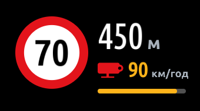
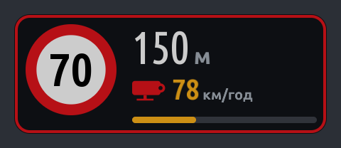
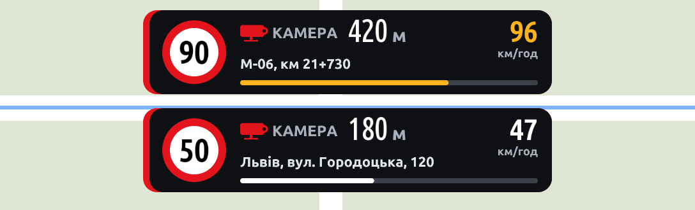
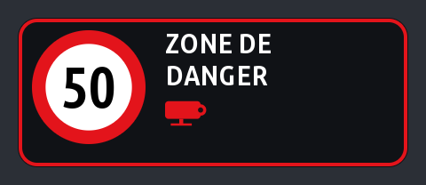
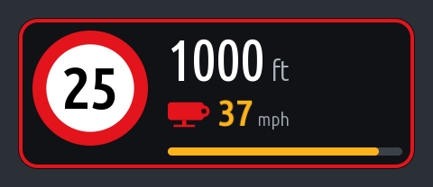
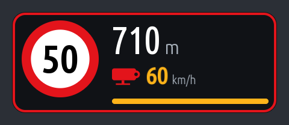
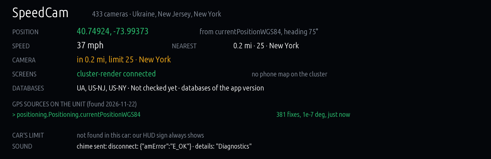

# SpeedCam — manual (BMW iDrive 7)

*Українською: [README.md](README.md) · Legal notice: [LEGAL.md](../../LEGAL.md)*

An offline app for the MGU head unit (iDrive 7). It takes the GPS position from the car's own navigation and warns of
fixed speed cameras on the head-up display (HUD), on the instrument cluster and inside the Waze / Google map on the
cluster: the speed limit sign, the distance, your speed and a bar that runs out at the camera, optionally with a chime.
No phone and no internet needed while driving.

| HUD | Instrument cluster | Inside the Waze / Google map |
|---|---|---|
|  |  |  |

| France: danger zone | USA: mph | German |
|---|---|---|
|  |  |  |



**Camera databases:** Ukraine — the Patrol Police's official list. Europe (EU, United Kingdom, Norway, Iceland,
Switzerland, the Balkans, Moldova) and the 50 US states — OpenStreetMap. One pack per country or state, updated
monthly.

**Languages:** Українська, English, Deutsch, Polski, Français, Italiano, Español, Čeština.

> Unofficial, not affiliated with BMW. Installing needs root access to the head unit. Warnings are for information
> only: follow the road signs. Check the local law before using it abroad (see "Countries and the law" below and
> [LEGAL.md](../../LEGAL.md)).

## Install

You need a head unit with root access, the [MGU Store](https://github.com/robertnisipeanu/mgu-store) and its
**cluster-render** service 0.5.1 or newer (in the Store; it comes with Cluster Themes or HUD Widgets).

1. Store → Settings → **Add source** → `Zakh294/bmw-sugar-apps`, branch `main` → **Check now**.
2. Store → **SpeedCam** → **Install**. While it builds (1–2 min) the head unit finds where its firmware publishes the
   car's position.
3. If *Restart pending* shows: Settings → **Restart head unit**.

The app starts by itself with the head unit and runs in the background; you don't have to open it.

## First check

1. **Apps menu → SpeedCam.** The status page opens.
   - **SCREENS** — green "cluster-render connected".
   - **GPS SOURCES ON THE UNIT** — at least one line. "No GPS source found": see "No position" below.
2. **"Test warning"** (parked is fine): a 14-second test warning on the HUD and the cluster — a "50" sign, 800 m
   counting down to 0, speed 72 in red.
3. **Drive a few hundred metres:** POSITION turns green with a heading, NEAREST shows the nearest camera.
4. **With Waze or Google Maps on the cluster** (Maps on cluster) press "Test warning" again: a banner at the top of
   the map.
5. **Drive past a camera:** the warning comes about 20 s before it (300 m at least) and goes once you passed it.

## Buttons on the page

| Button | What it does |
|---|---|
| Test warning | a 14 s test warning on every screen (and the chime when sound is on) |
| Camera databases | choose the databases (below) |
| Sound test | plays the chime and opens "Diagnostics" with every step |
| Diagnostics | the audio system's sources and sinks, the last chime; press again to go back |
| Settings | every setting (below) |

## Camera databases

An iDrive list screen ("Camera databases" button):

- **Active** — the packs in use now and their number of cameras.
- **Automatic: the country the car is in** (on by default) — the pack of the country or US state you are driving in
  comes in by itself. Cross a border and the neighbour's pack is in use within a minute.
- **Check for updates now** — without waiting for the month. The line below says when it was checked, the next date
  and an error if there was one.
- **Groups:** Ukraine · Europe · USA (states). Pick one; its packs are listed below with check boxes: name, number of
  cameras, "not allowed" or "zones only". "All" ticks or unticks the whole group.
- A tick = always in use, even when the car is elsewhere (e.g. Poland before a trip). A pack not in the car yet is
  downloaded right away.

## Settings

| Setting | Default | What it does |
|---|---|---|
| Мова / Language | automatic | the language of the page, the warnings, the buttons and the settings: "Automatic" = the language of the country the car is in (Ukraine Ukrainian, Germany and Austria German, Poland Polish…, English where none of the 8 is spoken), or one of the 8 |
| Camera warnings | on | main switch |
| When to show | at every camera | "Only when I am over the limit": warning and chime only above the limit (+ tolerance). A camera with no known limit always shows |
| Countries where warnings are not allowed (DE, CH…) | off | "On: at my own responsibility" — warn there too (see "Countries and the law") |
| Units | as in the camera's country | km/h and m/km; mph and ft/mi in the USA and the UK; or always km/h or mph |
| Warning sound | over the music | off / over the music / interrupts the music briefly / through the media player (pauses the music) |
| Sound | ding | ding, gong, three beeps, soft, radar |
| Alarm when over the limit | on | four quick beeps when your speed goes above the limit |
| Chime volume | 70 % | 30–100 % |
| Show on the HUD / on the cluster | on / on | which screens |
| Inside the Waze / Google map | on | a banner in the phone map when it is on the cluster |
| Place in the map / on the cluster (no map) | centre | left, centre, right |
| Warn ahead by / Not closer than | 20 s / 300 m | warning distance = speed × time, at least the minimum |
| Amber speed when over the limit by | 0 km/h | tolerance for amber and for "only when over" |
| Warning size | 100 % | 60–100 %, every screen |
| HUD brightness | 100 % | 40–100 %, HUD only |
| Dimmer at night | on | after sunset the HUD at 60 %, the cluster and the map at 80 % |
| Update the databases monthly | on | the monthly update (below) |

## Countries and the law

GPS warnings of fixed cameras are not allowed everywhere, so by default:

| Where | In the app | Why |
|---|---|---|
| Germany | **off** | StVO § 23 (1c): a driver may not use a device or app that warns of speed checks (EUR 75 and a point), even a passenger's phone |
| Switzerland, Liechtenstein | **off** | any device warning of speed checks is prohibited |
| Cyprus, North Macedonia | **off** | such services are not permitted there |
| France | **zones only** | only a "danger zone" may be announced, never the camera's place: "ZONE DE DANGER" from 2 km (4 km on a motorway), no distance |
| Ukraine, the rest of Europe, the USA | on | generally allowed; **check the local rules** |

This is not legal advice; laws change. Check the rules of every country before you drive there. Switching warnings
on where they are off by default is your own responsibility. Details: [LEGAL.md](../../LEGAL.md).

## Sound

A chime when a warning appears, and an alarm when your speed goes over the limit. The app connects one of BMW's audio
sources for apps to the front speakers, hands BMW's built-in media player a short WAV and disconnects the source.

| Route | Source | Sounds like |
|---|---|---|
| Over the music | `OAPGenericOverlay` (1048) | a navigation prompt, the music dips briefly |
| Interrupts the music | `OAPGenericInterrupt` (1047) | a call, the music stops briefly |
| Through the media player | `OAPGenericMedia` (1046) | instead of the music, then the source before comes back |

No chime? Play some music, press **"Sound test"** and look at the steps on "Diagnostics": connect, `playFile`, the
player's answer, disconnect. Try another route in Settings. "not on this unit: MediaPlayer: instance …" in red means
that player does not exist on your unit. The app notes its connection, so after a crash the next start removes it
and the music is not left ducked.

## Monthly database update

- On the 2nd of every month a GitHub workflow ([camera-packs.yml](../../.github/workflows/camera-packs.yml)) downloads
  the police list and OpenStreetMap, rebuilds the packs and commits the ones that changed.
- The car, once a month (or when you press "Check for updates now"), reads a small `index.json` from GitHub and
  downloads only the packs in use that changed: a few to a few hundred kilobytes. Every file is checked against its
  sha256 before it replaces the old one; any error keeps the previous packs.
- No connection: it tries again 6 hours later and keeps using the packs built into the app version.
- Free: GitHub Actions cost nothing for public repositories (a private one uses a few minutes a month of the free
  allowance). In the car: just those kilobytes of data. No position, VIN or other data is sent anywhere.
- New cameras in Europe and the USA appear when they are added to OpenStreetMap (`highway=speed_camera`). A camera
  missing or wrong? Fix it in OpenStreetMap; the next monthly build picks it up.

## How the warning works

- **Heading** from the movement: the bearing between two points at least 12 m apart. No new warnings below 8 km/h or
  while the heading is unknown.
- **Ahead** = within ±30° of the heading (±60° closer than 200 m, for bends).
- **Warning distance** = speed × 20 s, 300 m to 1.2 km (France: a zone from 2 / 4 km).
- **Speed** on the picture: white within the limit, amber over it (+ tolerance), red and blinking past +20 km/h.
- The warning goes once the camera is passed; that camera and any within 200 m (the other carriageway) stay quiet for
  2 minutes.
- **Layers** of class `alert`: above Cluster Themes, HUD Widgets and the Maps on cluster map; hidden when there is no
  warning.
- **The phone map** reaches the cluster as video only, without coordinates, so the warning is a banner in the map
  like the navigation's own notices, not an icon on a spot.

## No position

The firmware publishes the position under a name the search did not recognise. The diagnosis only reads the
catalogue. From **cmd** in the repository folder (key and address as in your MGU Store setup):

```bat
ssh -i %USERPROFILE%\.ssh\mgu_root_key -o HostKeyAlgorithms=+ssh-rsa -o PubkeyAcceptedAlgorithms=+ssh-rsa root@172.16.222.97 "node -" < tools\speedcam_ua\find_position.js
```

**The app's log:**
```bat
ssh -i %USERPROFILE%\.ssh\mgu_root_key -o HostKeyAlgorithms=+ssh-rsa -o PubkeyAcceptedAlgorithms=+ssh-rsa root@172.16.222.97 "tail -n 80 $(find / -name speedcam_ua.log 2>/dev/null | head -1)"
```
Useful lines: `position source: …`, `packs in use: …`, `update: …`, `cluster-render ready`, `camera ahead: …`,
`chime …`. The log holds no coordinates.

**The Store does not install the app** and names an interface (`IFConfigGenerator`, `Interface … not found`)? The GPS
search at build time is switched off by a file `apps/speedcam_ua/position.disable`; open an issue with the error.

## Limitations

- The police list has **no direction**, so a camera for the other carriageway warns too. OpenStreetMap sometimes has
  one (`direction`); it is kept in the packs but not used yet.
- **Mobile cameras** are not covered: fixed ones only.
- OpenStreetMap often lacks the limit (`maxspeed`): the sign shows "?", and such cameras always show.
- iDrive 7 (MGU) only; iDrive 8 has other cluster-render targets.

## For developers

```sh
python3 tools/speedcam_ua/import_cameras.py --fetch   # police list -> data/speedcam_ua/cameras.json
python3 tools/speedcam_ua/gen_app_data.py             # GeoJSON, CSV, KML, GPX for Ukraine
python3 tools/speedcam_ua/build_packs.py              # every pack (Overpass), or --only ua,pl, or --offline
python3 tools/bake_fonts_i18n.py <folder with the Ubuntu fonts>   # letters for new languages and pack labels
node test/speedcam_ua/unit.js && node test/speedcam_ua/e2e_drive.js && python3 test/speedcam_ua/packs_test.py
python3 kit/tools/build.py --preview-only speedcam_ua
```
The head unit runs Node **8.16.2**: no `?.`, `??`, `catch {}`, object spread. Languages: `apps/speedcam_ua/lang.js`;
countries and legal modes: `tools/speedcam_ua/countries.py`.

## Licences and thanks

- Code: MIT. `kit/`: MGU App Kit, © cauliflowermossgrape, MIT; its fonts extended with European letters from Ubuntu
  (Ubuntu Font Licence 1.0, `tools/bake_fonts_i18n.py`).
- `apps/speedcam_ua/cluster_render_client.js`: © Robert Nisipeanu, MPL-2.0.
- Data: the Ukrainian Patrol Police's list of enforcement devices; © OpenStreetMap contributors, ODbL 1.0.
- The sound path was shown by leschi/mgu-media-client, loenne007/idrive-enginesound (MIT) and the notes of
  Vizualyse/idrive-apps. No code was copied.
