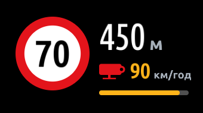
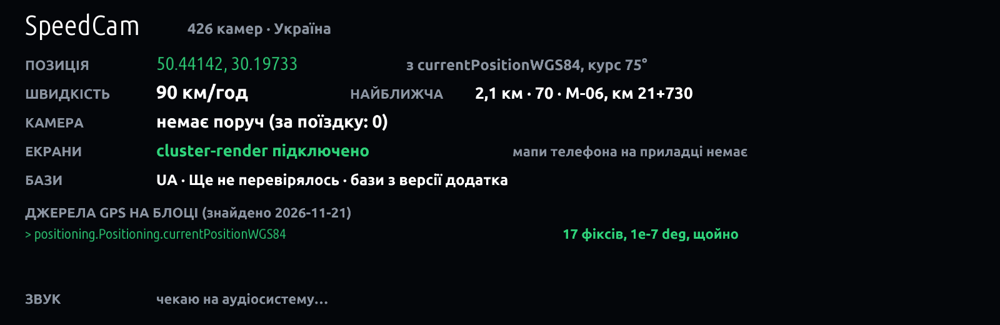

# SpeedCam — інструкція (BMW iDrive 7)

*English: [README.en.md](README.en.md) · Правова інформація: [LEGAL.md](../../LEGAL.md)*

Офлайн-додаток для головного блока MGU (iDrive 7). Бере GPS з навігації самої машини і попереджає про стаціонарні
камери швидкості на проєкції (HUD), на приладовій панелі та в мапі Waze / Google на приладці. Показує знак ліміту,
відстань до камери, твою швидкість і смужку, що зменшується до камери. За бажанням подає звуковий сигнал.
Телефон та інтернет у дорозі не потрібні.

| HUD | Приладка | У мапі Waze / Google |
|---|---|---|
|  |  |  |



**Бази камер:** Україна — офіційний список патрульної поліції. Європа (ЄС, Велика Британія, Норвегія, Ісландія,
Швейцарія, Балкани, Молдова) і 50 штатів США — OpenStreetMap. Бази окремі для кожної країни чи штату й оновлюються
раз на місяць.

**Мови:** українська, English, Deutsch, Polski, Français, Italiano, Español, Čeština.

> Неофіційний додаток, не від BMW. Для встановлення потрібен root-доступ до блока. Попередження довідкові: стеж за
> знаками. Перед використанням за кордоном перевір місцеві закони (див. «Країни й закон» нижче та
> [LEGAL.md](../../LEGAL.md)).

## Встановлення

Потрібні блок з root-доступом, [MGU Store](https://github.com/robertnisipeanu/mgu-store) і сервіс **cluster-render**
0.5.1 або новіший (є в Store, ставиться разом із Cluster Themes чи HUD Widgets).

1. Store → Settings → **Add source** → `Zakh294/bmw-sugar-apps`, гілка `main` → **Check now**.
2. Store → **SpeedCam** → **Install**. Під час збірки (1–2 хв) блок сам знаходить у своєму каталозі інтерфейсів,
   звідки брати координати машини.
3. Якщо з'явиться *Restart pending*: Settings → **Restart head unit**.

Додаток стартує сам з кожним запуском блока і працює у фоні. Відкривати його не обов'язково.

## Перша перевірка

1. **Меню додатків → SpeedCam.** Відкриється сторінка стану.
   - **ЕКРАНИ** — зелене «cluster-render підключено».
   - **ДЖЕРЕЛА GPS НА БЛОЦІ** — хоча б один рядок. Якщо пише «GPS-джерело не знайдено», див. «Якщо координат немає».
2. **«Тест попередження»** (можна на стоянці). На HUD і на приладці на 14 с з'явиться тестове попередження: знак
   «50», відстань від 800 м до 0, червона швидкість 72.
3. **Проїдь кілька сотень метрів.** У рядку ПОЗИЦІЯ з'являться зелені координати й курс, у рядку НАЙБЛИЖЧА —
   найближча камера.
4. **З Waze або Google Maps на приладці** (Maps on cluster) натисни «Тест попередження» ще раз: банер з'явиться вгорі
   мапи.
5. **Проїдь повз камеру.** Попередження з'являється приблизно за 20 с до неї (не ближче ніж за 300 м) і зникає,
   щойно проїхав.

## Кнопки внизу сторінки

| Кнопка | Що робить |
|---|---|
| Тест попередження | 14-секундне тестове попередження на всіх екранах (і сигнал, якщо звук увімкнено) |
| Бази камер | вибір баз (нижче) |
| Тест звуку | програє сигнал і відкриває «Діагностику» з кроками |
| Діагностика | джерела й виходи аудіосистеми та результат останнього сигналу; ще раз — назад |
| Налаштування | усі налаштування (нижче) |

## Бази камер

Екран зі списком у стилі iDrive (кнопка «Бази камер»):

- **Активні** — бази, які зараз у роботі, і кількість камер у них.
- **Автоматично: база країни, де машина** (увімкнено за замовчуванням) — база країни чи штату, де ти їдеш, вмикається
  сама. Перетнув кордон — за хвилину працює база сусідньої країни.
- **Перевірити оновлення зараз** — не чекаючи місяця. Рядок під кнопкою показує дату перевірки, наступну дату й
  помилку, якщо була.
- **Групи:** Україна · Європа · США (штати). Вибери групу, і нижче з'явиться список її баз із галочками: назва,
  кількість камер, позначка «заборонено» чи «лише зони». «Усі» вмикає чи вимикає всю групу.
- Галочка = база завжди в роботі, навіть коли машина деінде (наприклад, Польща перед поїздкою). Базу, якої ще немає
  в машині, додаток одразу завантажить.

## Налаштування

| Налаштування | Типово | Що робить |
|---|---|---|
| Мова / Language | автоматично | мова сторінки, попереджень, кнопок і налаштувань: «Автоматично» — мова країни, де машина (Україна — українська, Німеччина й Австрія — німецька, Польща — польська…, де жодна з 8 — англійська), або одна з 8 мов |
| Попередження про камери | так | загальний вимикач |
| Коли показувати | біля кожної камери | «Лише коли перевищую ліміт»: попередження й сигнал лише тоді, коли швидкість вища за ліміт (+ допуск). Камера без відомого ліміту показується завжди |
| Країни, де попередження заборонені (DE, CH…) | вимкнено | «Увімкнено: відповідальність на мені» — попереджати і там (див. «Країни й закон») |
| Одиниці | як у країні камери | км/год і м/км, у США й Великій Британії — mph і ft/mi; або завжди км/год чи mph |
| Звук попередження | поверх музики | вимкнено / поверх музики / перериває музику на мить / через медіаплеєр (музика стане на паузу) |
| Вид сигналу | дзень | дзень, гонг, три біпи, м'який, радар |
| Тривожний сигнал при перевищенні | так | коли швидкість стає вищою за ліміт — чотири швидкі біпи |
| Гучність сигналу | 70 % | 30–100 % |
| Показувати на HUD / на приладці | так / так | на яких екранах |
| Всередині мапи Waze / Google | так | банер у мапі телефона, коли вона на приладці |
| Місце в мапі / на приладці без мапи | по центру | ліворуч, по центру, праворуч |
| Попереджати за / Не ближче ніж за | 20 с / 300 м | відстань попередження = швидкість × час, не менше за мінімум |
| Жовта швидкість, якщо понад ліміт на | 0 км/год | допуск для жовтого кольору і для режиму «лише коли перевищую» |
| Розмір попередження | 100 % | 60–100 %, на всіх екранах |
| Яскравість на HUD | 100 % | 40–100 %, лише HUD |
| Вночі тьмяніше | так | після заходу сонця HUD до 60 %, приладка й мапа до 80 % |
| Оновлювати бази раз на місяць | так | щомісячне оновлення (нижче) |
| Зроблено в Україні | — | не перемикач, а нагадування: Росія — держава-агресор, підтримай Україну (u24.gov.ua) |

## Країни й закон

Попередження про стаціонарні камери за GPS дозволені не всюди. Тому за замовчуванням:

| Де | У додатку | Чому |
|---|---|---|
| Німеччина | **вимкнено** | StVO § 23 (1c): водієві не можна користуватися пристроєм чи застосунком, що попереджає про контроль швидкості (штраф 75 € і бал), навіть телефоном пасажира |
| Швейцарія, Ліхтенштейн | **вимкнено** | заборонені будь-які пристрої, що попереджають про контроль |
| Кіпр, Північна Македонія | **вимкнено** | такі сервіси там не дозволені |
| Франція | **лише зони** | можна попереджати лише про «небезпечну зону», не про місце камери: додаток показує «ЗОНА КОНТРОЛЮ» за 2 км (4 км на автомагістралі), без відстані |
| Україна, інші країни Європи, США | працює | загалом дозволено; **перевір місцеві правила** |

Це не юридична порада. Закони змінюються, тож перед поїздкою перевір правила кожної країни. Якщо вмикаєш
попередження там, де вони вимкнені за замовчуванням, відповідальність на тобі. Подробиці: [LEGAL.md](../../LEGAL.md).

## Звук

Сигнал звучить, коли з'являється попередження, і ще раз (тривожний), коли швидкість стає вищою за ліміт. Додаток
підключає джерело застосунків аудіосистеми BMW до передніх динаміків, дає вбудованому медіаплеєру BMW короткий
WAV-файл і відразу відключає джерело.

| Маршрут | Джерело | Як звучить |
|---|---|---|
| Поверх музики | `OAPGenericOverlay` (1048) | як підказка навігації, музика стихає на мить |
| Перериває музику | `OAPGenericInterrupt` (1047) | як дзвінок, музика стає на мить |
| Через медіаплеєр | `OAPGenericMedia` (1046) | замість музики, потім повертається джерело, що грало |

Не чути сигналу? Увімкни музику, натисни **«Тест звуку»** і подивись кроки на сторінці «Діагностика»:
з'єднання, `playFile`, відповідь плеєра, відключення. Спробуй інший маршрут у Налаштуваннях. Напис червоним
«немає на блоці: MediaPlayer: instance …» означає, що цього плеєра на блоці немає. Номер свого з'єднання додаток
записує, тож після збою наступний старт його прибере, і музика не залишиться приглушеною.

## Щомісячне оновлення баз

- 2-го числа щомісяця робочий процес на GitHub ([camera-packs.yml](../../.github/workflows/camera-packs.yml))
  завантажує свіжий список поліції та OpenStreetMap, перебудовує бази й записує в репозиторій ті, що змінилися.
- Машина раз на місяць (і коли натиснеш «Перевірити оновлення зараз») читає з GitHub короткий `index.json` і
  завантажує лише ті бази в роботі, що змінилися: від кількох до кількох сотень кілобайт. Кожен файл перевіряється за
  sha256 до того, як замінить старий. Будь-яка помилка залишає попередні бази.
- Немає зв'язку — додаток спробує знову через 6 годин, а доти працює з базами, вбудованими у версію.
- Індекс машина бере з останнього релізу `packs-…` на GitHub, а якщо не вдалося — з гілки `main`. GitHub рахує
  завантаження індексу, і так ми приблизно бачимо, скільки машин користується додатком: [STATS.md](STATS.md)
  (оновлюється щомісяця). Більше нічого не збирається.
- Нічого не коштує: GitHub Actions безкоштовні для публічних репозиторіїв (для приватних витрачається кілька хвилин
  на місяць з безкоштовного ліміту). У машині — лише ці кілобайти трафіку. Позиція, VIN чи інші дані нікуди не
  надсилаються.
- Нові камери в Європі й США з'являються, коли їх додають в OpenStreetMap (`highway=speed_camera`). Бракує камери чи
  вона зайва — виправ в OpenStreetMap, і наступна місячна збірка це підхопить.

## Як працює попередження

- **Курс** — з руху: азимут між двома точками щонайменше за 12 м одна від одної. Нових попереджень немає повільніше
  8 км/год або поки курс не відомий.
- **Попереду** — камера в межах ±30° від курсу (±60° ближче 200 м, на поворотах).
- **Відстань попередження** = швидкість × 20 с, від 300 м до 1,2 км (Франція: зона від 2 / 4 км).
- **Швидкість** на рисунку біла в межах ліміту, жовта понад ліміт (+ допуск), червона й блимає понад +20 км/год.
- Попередження зникає, коли камеру проїхали. Ця камера та камери в радіусі 200 м (зустрічна смуга) мовчать 2 хв.
- **Шари** класу `alert` — поверх тем Cluster Themes, HUD Widgets і мапи Maps on cluster. Без попередження шари
  приховані.
- **Мапа телефона** приходить на приладку лише відео, без координат. Тому попередження — банер у мапі, як власні
  сповіщення навігації, а не значок на точці.

## Якщо координат немає

У прошивці координати лежать під іменем, яке пошук не впізнав. Діагностика лише читає каталог. Команда для **cmd**
з папки репозиторію (ключ і адреса — як у твоєму встановленні MGU Store):

```bat
ssh -i %USERPROFILE%\.ssh\mgu_root_key -o HostKeyAlgorithms=+ssh-rsa -o PubkeyAcceptedAlgorithms=+ssh-rsa root@172.16.222.97 "node -" < tools\speedcam_ua\find_position.js
```

**Лог додатка:**
```bat
ssh -i %USERPROFILE%\.ssh\mgu_root_key -o HostKeyAlgorithms=+ssh-rsa -o PubkeyAcceptedAlgorithms=+ssh-rsa root@172.16.222.97 "tail -n 80 $(find / -name speedcam_ua.log 2>/dev/null | head -1)"
```
Корисні рядки: `position source: …`, `packs in use: …`, `update: …`, `cluster-render ready`, `camera ahead: …`,
`chime …`. Координат у лозі немає.

**Store не встановлює додаток** і пише про інтерфейс (`IFConfigGenerator`, `Interface … not found`)? Пошук GPS при
збірці вимикається файлом `apps/speedcam_ua/position.disable`; відкрий issue з текстом помилки.

## Обмеження

- У списку поліції **немає напрямку**, тож камера для зустрічної смуги теж попереджає. В OpenStreetMap напрямок
  буває (`direction`), він збережений у базах, але поки не використовується.
- **Пересувні камери і «Фантоми»** не враховуються: лише стаціонарні.
- В OpenStreetMap часто бракує ліміту (`maxspeed`) — тоді на знаку «?», і такі камери показуються завжди.
- Лише iDrive 7 (MGU). На iDrive 8 цілі cluster-render інші.

## Для розробника

```sh
python3 tools/speedcam_ua/import_cameras.py --fetch   # список поліції -> data/speedcam_ua/cameras.json
python3 tools/speedcam_ua/gen_app_data.py             # GeoJSON, CSV, KML, GPX для України
python3 tools/speedcam_ua/build_packs.py              # усі бази (Overpass), або --only ua,pl, або --offline
python3 tools/bake_fonts_i18n.py <папка зі шрифтами Ubuntu>   # літери для нових мов і назв у базах
node test/speedcam_ua/unit.js && node test/speedcam_ua/e2e_drive.js && python3 test/speedcam_ua/packs_test.py
python3 kit/tools/build.py --preview-only speedcam_ua
```
Блок працює на Node **8.16.2**: без `?.`, `??`, `catch {}`, object spread. Мови — `apps/speedcam_ua/lang.js`,
країни й правові режими — `tools/speedcam_ua/countries.py`.

## Ліцензії та подяки

- Код — MIT. `kit/` — MGU App Kit, © cauliflowermossgrape, MIT; його шрифти доповнені європейськими літерами з
  Ubuntu (Ubuntu Font Licence 1.0, `tools/bake_fonts_i18n.py`).
- `apps/speedcam_ua/cluster_render_client.js` — © Robert Nisipeanu, MPL-2.0.
- Дані: перелік приладів контролю патрульної поліції України; © учасники OpenStreetMap, ODbL 1.0.
- Шлях до звуку підказали leschi/mgu-media-client, loenne007/idrive-enginesound (MIT) і нотатки Vizualyse/idrive-apps.
  Код не запозичено.
